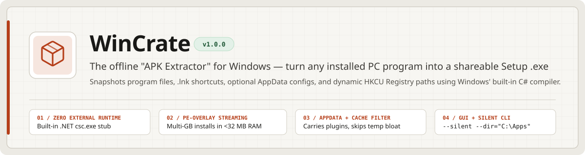
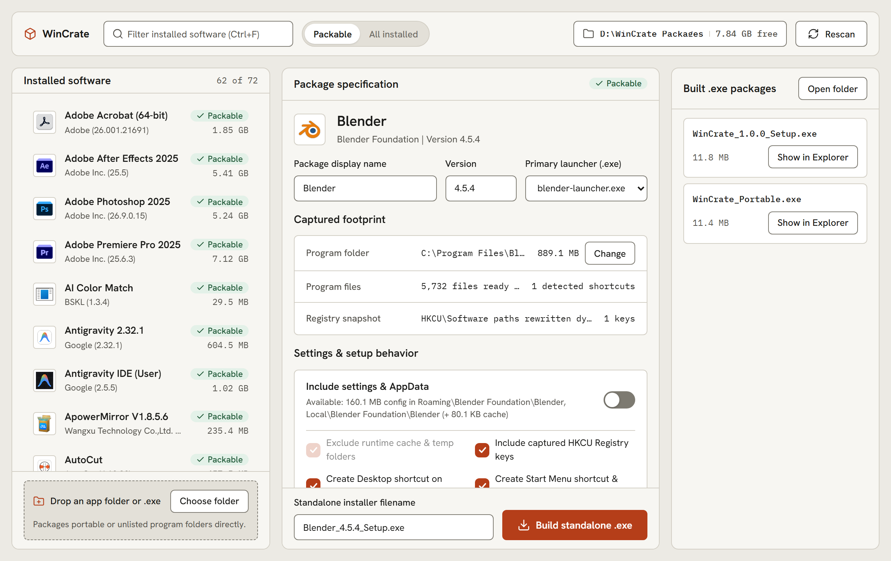
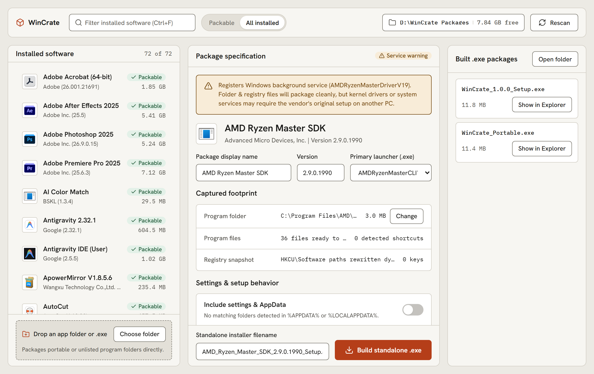
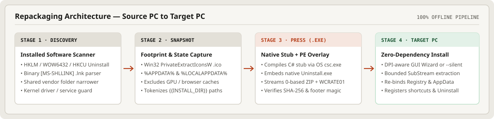
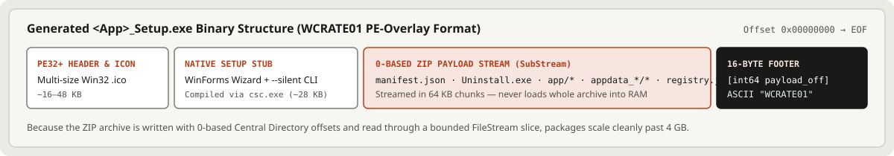

<div align="center">



<br>

[](https://github.com/piyushmaurya6/wincrate/releases/latest)
[](https://github.com/piyushmaurya6/wincrate/actions/workflows/ci.yml)
[-ECEAE4?style=flat-square&labelColor=191917)](https://github.com/piyushmaurya6/wincrate)
[-F6E6DF?style=flat-square&labelColor=191917)](https://github.com/piyushmaurya6/wincrate#architecture--binary-format)
[](LICENSE)

**Inspect any software already installed on your Windows PC and press it into a standalone, zero-dependency `<App>_Setup.exe` you can copy to another PC offline.**

[Download Standalone `.exe`](#-download-for-windows-zero-python-required) · [How It Works](#architecture--binary-format) · [Similar Tools Comparison](#why-wincrate--ecosystem-comparison) · [Silent CLI Flags](#silent--automated-install-flags) · [Build from Source](#development--building-from-source)

</div>

---

## Overview

On Android, utilities like **APK Extractor** let you grab an already-installed app and share its `.apk` file with another phone offline—even when you no longer have the original installer. On Windows, installed applications scatter files across `Program Files`, `.lnk` shortcuts, `%APPDATA%` / `%LOCALAPPDATA%`, and `HKCU\Software` Registry paths.

**WinCrate** brings that one-click workflow to Windows:

1. **Discovers installed desktop software** in under a second across 64-bit, `WOW6432Node`, and `HKCU` Uninstall Registry hives plus Start Menu and Desktop `.lnk` files.
2. **Narrows shared vendor directories** (e.g., isolating `Adobe Photoshop 2025` instead of sweeping all of `C:\Program Files\Adobe`) and flags apps that rely on kernel drivers or system services before you build.
3. **Optionally bundles `%APPDATA%` & `%LOCALAPPDATA%` settings and plugins** while automatically skipping browser, shader, and GPU runtime caches.
4. **Compiles a native Windows Setup `.exe`** using Windows' built-in C# compiler (`csc.exe`), embedding the application's real Win32 `.ico` icon, a native `Uninstall.exe`, and a `WCRATE01` PE-overlay payload stream that installs multi-GB software in under `32 MB` of RAM.

<br>

<div align="center">
  
  <p><em>WinCrate's 3-column command board: scanned Windows applications on the left, live footprint &amp; AppData/Registry ledger in the center, and ready-to-share Setup <code>.exe</code> packages on the right.</em></p>
</div>

---

## Download for Windows (Zero Python Required)

Grab either standalone executable from [**GitHub Releases (`v1.0.0`)**](https://github.com/piyushmaurya6/wincrate/releases/latest) — neither requires Python, `.NET SDK`, or internet access on your PC or the recipient's PC:

| Package | Size | Best For | Direct Link |
| :--- | :--- | :--- | :--- |
| **`WinCrate_Portable.exe`** | `11.4 MB` | **Copy & double-click anywhere** — single-file portable executable; unpacks its self-contained runtime once on first launch and opens immediately thereafter. | [**Download Portable `.exe`**](https://github.com/piyushmaurya6/wincrate/releases/latest/download/WinCrate_Portable.exe) |
| **`WinCrate_1.0.0_Setup.exe`** | `11.8 MB` | **Permanent desktop install** — native Setup Wizard (built by WinCrate itself) with Desktop & Start Menu shortcuts and Windows `Uninstall.exe`. | [**Download Setup `.exe`**](https://github.com/piyushmaurya6/wincrate/releases/latest/download/WinCrate_1.0.0_Setup.exe) |

---

## Why WinCrate? — Ecosystem Comparison

Before building WinCrate, we surveyed existing Windows migration, packaging, and installer tools. Each solves a different slice of the problem, leaving a clear gap for an **open-source, post-install offline `.exe` repackager**:

| Tool / Category | Open Source | Extracts *Already-Installed* Apps | Works 100% Offline on Target PC | Outputs Single Shareable `.exe` | Captures AppData + Rewrites Registry Paths |
| :--- | :---: | :---: | :---: | :---: | :---: |
| **WinCrate** | **Yes (MIT)** | **Yes** | **Yes** | **Yes** | **Yes (with cache filter)** |
| **Winget (`winget export`) / UniGetUI** | Yes | Lists IDs only | No (re-downloads online) | No (`.json` manifest) | No |
| **Inno Setup / NSIS / WiX Toolset** | Yes | Manual folder hunt & scripting | Yes | Yes | Manual scripting only |
| **MSIX Packaging Tool / Cameyo** | No | No (must record fresh install on clean VM) | Yes | `.msix` / virtualized `.exe` | Snapshot during fresh install only |
| **PickMeApp** | No (Commercial) | Yes | Partial | Proprietary `.tap` / Pro-gated | Yes |
| **EaseUS Todo PCTrans / PCmover** | No (Paid suite) | Yes | Requires suite on both PCs | No | Paid transfer session |
| **CloneApp** | Yes | Config backup only (no app binaries) | Yes | No | Config files only |

### Honest Scope & Compatibility Guardrails

Windows user-space repackaging works cleanly for the vast majority of standalone desktop tools, creative apps, utilities, IDEs, and portable folders. However, WinCrate is transparent about OS-level limits:

- **Kernel Drivers & Background Services:** Applications that install Ring-0 `.sys` drivers or `HKLM\SYSTEM\CurrentControlSet\Services` daemons are automatically detected and flagged with an amber **Service warning** banner so you know when a vendor's original installer may still be needed.
- **Hardware-Bound DRM & Online Activations:** Machine-fingerprinted commercial licenses or Microsoft Store `UWP / WindowsApps` encrypted containers cannot be bypassed or transferred across hardware IDs.

<br>

<div align="center">
  
  <p><em>Automatic service/driver detection surfaces compatibility exceptions upfront before you press a package.</em></p>
</div>

---

## Architecture & Binary Format

<div align="center">
  
</div>

<br>

<div align="center">
  
</div>

### Key Engineering Details

- **Zero External Compiler Toolchain (`csc.exe`):** Every Windows 10 and Windows 11 installation ships with `.NET Framework 4.0.30319` (`C:\Windows\Microsoft.NET\Framework64\v4.0.30319\csc.exe`). WinCrate compiles a DPI-aware WinForms Setup Wizard (`wincrate/stub_template.cs`) and matching `Uninstall.exe` (`wincrate/uninstaller_template.cs`) directly on the host machine—no Visual Studio, WiX, or Inno Setup installation required.
- **Bounded `SubStream` PE-Overlay Archive (`WCRATE01`):** Instead of embedding payloads as `.NET` managed resources (which hit `2 GB` array limits and spike RAM), WinCrate writes a `0`-based `ZIP_DEFLATED` archive onto the end of the PE binary followed by a 16-byte footer (`[int64 payload_offset]["WCRATE01"]`). The C# installer slices `FileStream` via a zero-copy `SubStream` and streams entries in `64 KB` chunks.
- **Dynamic Registry Path Tokenization:** Captured `HKCU\Software\<Publisher>\<App>` values containing user-specific paths (`C:\Users\Alice\...` or the original install directory) are tokenized into `{{USER_PROFILE}}` and `{{INSTALL_DIR}}` at pack time and rewritten to match the target PC's username and chosen folder at install time.
- **Native Win32 Icon Pipeline:** Extracts multi-resolution icons directly from `.exe` / `.dll` PE resources via `user32.PrivateExtractIconsW` + `gdi32.CreateDIBSection` (`wincrate/icon_extractor.py`), stamping the real application icon onto every generated `<App>_Setup.exe`.
- **Smart Disk-Space Staging:** Automatically checks volume free space before building and defaults to secondary fixed drives when `C:` is low on space, staging temporary archives on the destination volume so `C:\Users\...\Temp` never overflows.

---

## Silent & Automated Install Flags

Every `<App>_Setup.exe` generated by WinCrate works both interactively (double-click to open the Setup Wizard) and headlessly from PowerShell or CMD for batch provisioning onto a new PC:

```powershell
# Silent install to default %LOCALAPPDATA%\Programs\<App> with shortcuts & uninstaller
.\Blender_4.5.4_Setup.exe --silent

# Custom target directory without Desktop/Start Menu shortcuts
.\Blender_4.5.4_Setup.exe --silent --dir="D:\Apps\Blender" --no-shortcuts

# Portable extraction only (skip Registry keys and Windows Uninstall registration)
.\Blender_4.5.4_Setup.exe --silent --dir="E:\PortableApps\Blender" --no-shortcuts --no-registry --no-uninstaller
```

---

## Development & Building from Source

### Prerequisites
- Windows 10 or Windows 11 (x64)
- Python `3.10+`

### Run in Desktop Window

```powershell
git clone https://github.com/piyushmaurya6/wincrate.git
cd wincrate
python -m pip install -r requirements.txt
python app.py
```

### Build Shareable Standalone `.exe` Distributables

To compile both `WinCrate_Portable.exe` (single-file portable app) and `WinCrate_1.0.0_Setup.exe` (full Setup Wizard installer) with an isolated embedded Python + Edge WebView2 runtime:

```powershell
python build_standalone.py
```

### Run Headless Integrity Check

```powershell
python app.py --self-test
```

---

## Repository Structure

```text
wincrate/
├── app.py                        # Desktop WebView2 entrypoint (+ browser fallback & --self-test)
├── build_standalone.py           # Builds zero-Python WinCrate_Portable.exe & WinCrate_1.0.0_Setup.exe
├── DESIGN.md                     # Linen-press design system tokens, contrast ratios & layout spec
├── requirements.txt              # Python runtime dependencies (pywebview, pythonnet, Pillow)
├── pyproject.toml                # Package metadata
├── wincrate/
│   ├── scanner.py                # Registry Uninstall + binary [MS-SHLLINK] .lnk + AppData/service scanner
│   ├── icon_extractor.py         # Win32 PrivateExtractIconsW / SHGetFileInfoW -> PNG & multi-size .ico
│   ├── builder.py                # Threaded csc.exe compiler, WCRATE01 PE-overlay streamer & SHA-256 verifier
│   ├── server.py                 # Local 127.0.0.1 ThreadingHTTPServer JSON API & native folder dialogs
│   ├── stub_template.cs          # Target-PC WinForms Setup Wizard & --silent CLI installer (C# 5)
│   ├── uninstaller_template.cs   # Target-PC native Uninstall.exe bundled inside generated packages
│   ├── portable_stub.cs          # Single-file self-extracting bootstrapper for WinCrate_Portable.exe
│   ├── launcher.cs               # Native GUI launcher (no console window)
│   └── wincrate.ico              # Multi-resolution application icon
├── ui/
│   ├── index.html                # 3-column Shell Command Board markup
│   ├── tokens.css                # CSS custom properties synchronized with DESIGN.md
│   ├── styles.css                # Layout, ruled footprint ledger & responsive breakpoints
│   ├── interaction-kit.css       # Tactile press, switch, checkbox & segmented tab motion primitives
│   ├── interaction-kit.js        # Sliding segmented indicator & keyboard navigation helpers
│   └── app.js                    # Frontend state, live inspection, drag-and-drop & build polling
└── docs/assets/                  # Hero SVG banner, architecture diagrams & 2x product screenshots
```

---

## License

Released under the [MIT License](LICENSE).
